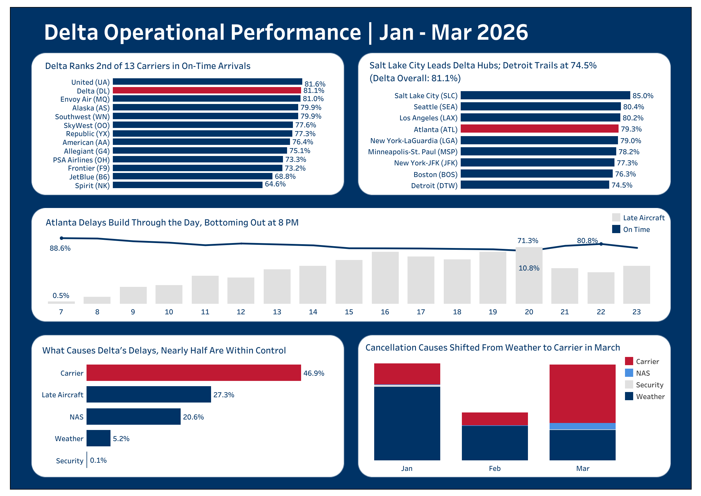

# Delta Hub Operational Performance Analysis

An end-to-end analysis of Delta Air Lines' on-time performance, delay causes, and cancellations across its hubs, using U.S. DOT flight data for January–March 2026 (1.67M flights across all U.S. carriers).

[**View the interactive Tableau dashboard**](https://public.tableau.com/app/profile/emma.lysinger/viz/DeltaOperationalPerformance/Dashboard2)



## Key Findings

1.  **Delta ranked 2nd of 13 reporting carriers in on-time arrivals (81.1%)**, just behind United (81.6%), while flying the 2nd-most flights (232K, behind only Southwest). United ranked 5th in volume.
2.  **Atlanta handled about 4x more Delta departures than any other hub** (54,144) with a 79.3% on-time rate, slightly below Delta's overall 81.1%. Salt Lake City led the hubs at 85.0%, and Detroit trailed at 74.5%.
3.  **Nearly half (46.9%) of Delta's delay minutes came from carrier-controlled causes** like maintenance, crew, and ground handling. Another 27.3% came from late-arriving aircraft, meaning earlier delays spread into later flights.
4.  **Delays build through the day at Atlanta.** On-time rates fell from 88.6% for 7 AM departures to a low of 71.3% for 8 PM, while the share of flights hit by late-arriving aircraft rose from 0.5% to 10.8%. Performance recovered for the last departures of the night (80.8% at 10 PM).
5.  **Cancellation drivers changed month to month.** In January (3.94%), 76% were weather-related. February had the lowest rate (2.09%), and 73% of those were also weather-related. In March (3.56%), 61% were carrier-related, meaning within Delta's control.

## Tools

Python (pandas), SQL (SQLite), Tableau

## Project Structure

```         
delta-ops-analysis/
├── data/                # raw BTS CSVs (not tracked in git)
├── results/             # query outputs used by the Tableau dashboard
├── load_data.py         # combines monthly CSVs into a SQLite database (flights.db)
├── queries.sql          # the five analysis queries
├── export_results.py    # runs queries.sql and exports results to CSV
├── requirements.txt
└── README.md
```

## Data Source

U.S. Bureau of Transportation Statistics (BTS), Reporting Carrier On-Time Performance (1987–present).

To download:

1.  Go to <https://www.transtats.bts.gov/tables.asp?QO_VQ=EFD&QO_anzr=Nv4yv0r>
2.  Find **Reporting Carrier On-Time Performance (1987-present)** (not the Marketing Carrier table) and click **Download**.
3.  Check these fields: FL_DATE, OP_UNIQUE_CARRIER, ORIGIN, DEST, CRS_DEP_TIME, DEP_DELAY, ARR_DELAY, ARR_DEL15, CANCELLED, CANCELLATION_CODE, DIVERTED, CARRIER_DELAY, WEATHER_DELAY, NAS_DELAY, SECURITY_DELAY, LATE_AIRCRAFT_DELAY
4.  Set the year to 2026 and download January, February, and March one at a time.
5.  Rename the files `2026_01.csv`, `2026_02.csv`, `2026_03.csv` and place them in `data/`.

## How to Run

```         
pip install -r requirements.txt
python load_data.py        # builds flights.db (~1.67M rows)
python export_results.py   # runs queries.sql, writes 5 CSVs to results/
```

Then connect Tableau to the CSVs in `results/`.

To explore the data or test queries by hand, open `flights.db` in DB Browser for SQLite.

## Scope and Definitions

- **Delta = Delta mainline only.** The data uses the operating (reporting) carrier, so `DL` covers flights Delta flies itself. Delta Connection flights operated by regional partners (e.g., Endeavor, SkyWest) are not included.
- **On-time** means arriving less than 15 minutes after the scheduled arrival time (the DOT standard).
- **Hub performance** is the on-time *arrival* rate of Delta flights *departing* each hub.
- **On-time rates exclude cancelled and diverted flights.** Cancellation rates use all scheduled flights.
- **Hubs analyzed:** ATL, DTW, MSP, SLC, JFK, LGA, BOS, SEA, LAX.

## Data Notes

- Raw downloads should be kept unedited. Opening and re-saving CSVs in Excel can reformat values.
- FL_DATE is formatted like `1/1/26 0:00`. `load_data.py` parses it and adds a `MONTH` column used in the cancellation query.
- CRS_DEP_TIME is stored without leading zeros (e.g., `600` for 6:00 AM). The hour calculation handles this.
